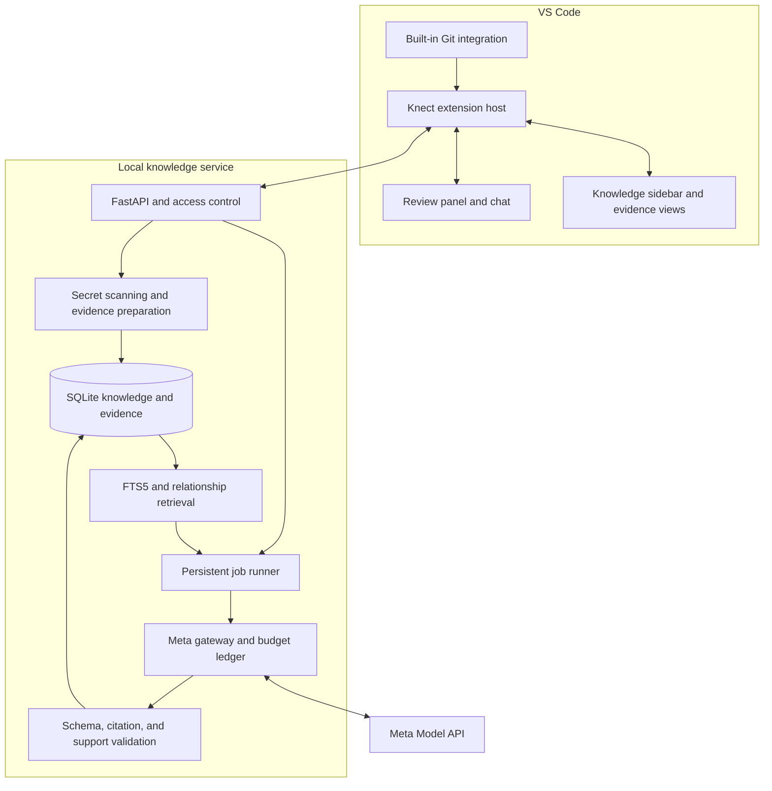
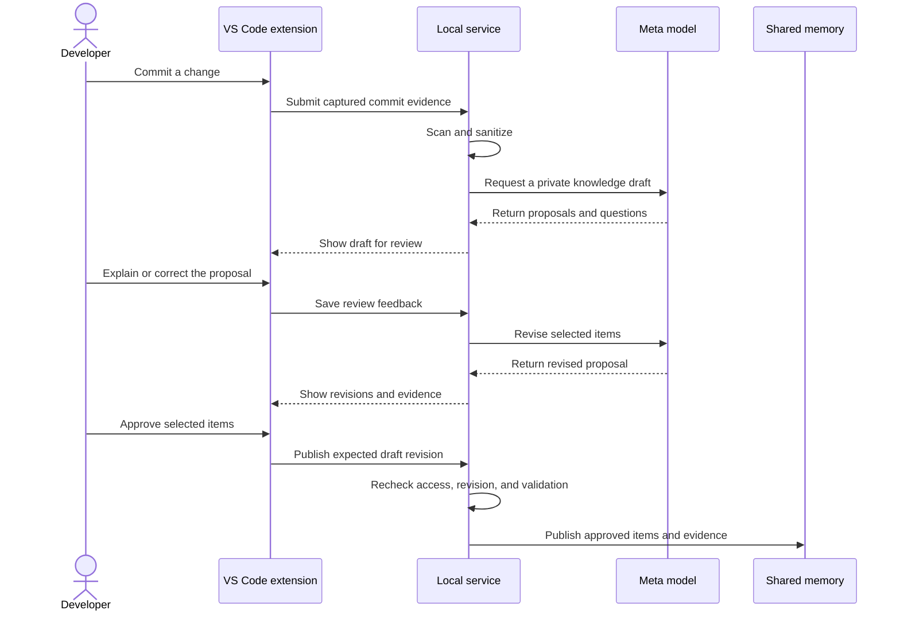

### `PLAN.md`

The following technical choices also account for VS Code’s [Workspace Trust requirements](https://code.visualstudio.com/api/extension-guides/workspace-trust). Model budgeting uses Meta’s [published standard rates](https://dev.meta.ai/docs/pricing-rate-limits); account eligibility and spending enforcement still require verification.

````markdown
# Knect — Engineering and Delivery Plan

This document defines how to build the product described in [README.md](README.md). It covers the VS Code integration, knowledge lifecycle, system boundaries, evaluation, budget, and delivery sequence.

**Status:** Approved design direction; implementation remains pending explicit approval. No application code, deployment, or live evaluation has been completed.

## 1. Delivery decision and feasibility

Build Knect as a desktop VS Code extension backed by a local FastAPI service. The extension provides repository awareness and the complete user experience; the service manages evidence, knowledge, model requests, access control, and usage.

This is a credible hackathon scope for one human working with AI assistance, provided the central workflow is completed before secondary features are added. The release must demonstrate a real transition from a code change to reviewed knowledge that another contributor can retrieve.

Two product decisions are fixed:

- Knowledge publication requires human approval, while Git commits and pushes remain unblocked.
- Feedback improves project memory and future proposals through retrieval and explicit rules. Actual model training is not required for this release.

A separate browser application, public hosting, and a training pipeline are excluded. Removing these parallel delivery paths gives us one integrated product to finish.

## 2. Required product boundary

The release supports trusted local Git repositories, contributor notes, selected Markdown documents, and structured experiment records. Contributors use one shared local service through separate authenticated VS Code sessions.

| Required capability | Completion condition |
|---|---|
| Repository connection | A user explicitly enables an identified repository for a workspace. |
| Change capture | New commits create deduplicated review opportunities with immutable references. |
| Knowledge drafting | Meta proposes evidence-linked findings without inventing missing motivation. |
| Conversational review | A developer can explain, correct, and selectively approve the proposed update. |
| Team knowledge | Published contributions become searchable by authorized workspace members. |
| Contextual guidance | Opening a relevant file reveals linked decisions and warnings. |
| Reassessment | Later evidence can mark guidance for review without erasing its history. |
| Knowledge transfer | A contributor can request a cited component explanation or handover. |
| Feedback reuse | Relevant approved corrections inform later proposals within their intended scope. |
| Operational reliability | Restart, budget exhaustion, and provider failure preserve existing knowledge. |

The initial limits are three connected repositories, three demonstration accounts, and 10,000 indexed evidence chunks per workspace. A change set may contain at most 50 files and 200 KB of selected text before the user must narrow the selection.

Excluded features include autonomous code changes, Git push enforcement, arbitrary web ingestion, rich-media processing, enterprise identity, public multi-tenant hosting, and continuous model training.

## 3. Architecture and technology



| Component | Choice and purpose |
|---|---|
| Extension | TypeScript with the VS Code Extension API for repository events, commands, notifications, and file navigation. |
| Interface | Native sidebar views and a React webview for the interactive review and chat surface; styles use VS Code theme variables. |
| Backend | Python 3.12, FastAPI, and Pydantic for validated requests and controlled workflows. |
| Persistence | SQLite through Python’s standard library, with numbered transactional migrations. |
| Retrieval | SQLite FTS5, structured fields, and explicit evidence relationships. |
| Secret detection | Gitleaks with application-controlled configuration and additional file exclusions. |
| Model transport | HTTPX calling Meta directly through one application gateway. |
| Testing | pytest for backend behavior and the VS Code extension test harness for editor workflows. |
| Distribution | An installable VSIX accompanied by the documented local service setup. |

There is no separate web application, vector database, graph database, queue service, or agent framework. All model inference uses Meta; local search and validation are deterministic application operations.

The service runs as one process with one durable job worker and one external inference request in flight. Database transactions remain short and never span a network request. Use SQLite’s default rollback journal for the initial workload.

## 4. VS Code integration

### Connection and activation

A contributor runs `Knect: Connect Workspace`, pairs with the local service, and selects the repositories to enable. The extension requires Workspace Trust before inspecting repository content or running local Git operations.

Pairing also presents the external-inference boundary: selected sanitized code and explanations may be sent to Meta. Repository monitoring and permission to use Meta are explicit settings, separate from approval to publish knowledge.

Use the built-in `vscode.git` extension for repository discovery and supported commit and state events. Check its capabilities at activation and pin the minimum tested VS Code version in the extension manifest.

### Change detection

Use the Git extension’s commit event for editor-driven commits. Also observe repository state changes to identify commits made through the terminal while VS Code is running.

Compare the recorded branch and HEAD before generating a review opportunity. A branch checkout is not a new contribution. A non-descendant HEAD change, such as a rebase or reset, requires an explicit catch-up review rather than automatic interpretation as new work.

On reopening a repository, offer `Review recent commits` for changes made while Knect was inactive. Do not assume the extension observes repositories when VS Code is closed.

Every change set records repository identity, branch, base commit, head commit, changed paths, and selected evidence. Deduplicate by repository, commit range, and selection fingerprint.

For an ordinary commit, compare it with its parent. For a merge commit, use its first-parent difference and label it as a merge. Handle an initial commit as additions against an empty tree.

### Review notification

After a draft is available, show one non-modal notification: “A knowledge update is ready to review,” with Review and Later actions. Later keeps it in the queue; it does not discard the contribution.

Batch rapid events to avoid repeated notifications. File saves do not trigger model calls. Commits and pushes never wait for Knect.

### Git and evidence safety

Use read-only Git operations with argument arrays, fixed operation types, validated revisions, and bounded output. Disable external diff and text-conversion helpers when obtaining evidence. Never execute a command supplied by a model or imported document.

Read evidence from the captured commit, not the mutable working tree. When a citation points to an older revision, open a read-only Knect evidence document. Only navigate to the working file when the mapped content still matches.

The extension does not install Git hooks, stage files, create commits, push changes, or modify repository content.

## 5. Capture, discuss, and publish

A change set first enters a private review area. Its evidence and discussion are visible to its author and authorized reviewers, but do not enter shared search.

The model proposes independently reviewable knowledge items containing a statement, type, conditions, evidence, and unresolved questions. It distinguishes observable code changes from explanations supplied by the developer.

When motivation is unclear, it asks a targeted question. For example, “What failure led to this retry change?” is preferable to an invented explanation about performance.



Chat messages refine a proposal; they do not authorize publication. After an AI revision, the developer sees what changed and explicitly approves the final items.

Raw review conversations remain private unless the author explicitly chooses to publish an excerpt. The shared record contains the approved explanation, not the entire chat history.

Publication atomically stores the selected knowledge revisions and their supporting evidence. Approval of one change set does not imply that every earlier commit was reviewed.

## 6. Knowledge, provenance, and review states

Keep immutable evidence separate from its interpretation.

| Record | Required information |
|---|---|
| Workspace and membership | Workspace identity, user identity, role, and access status. |
| Repository | Stable workspace identity and mappings to registered local roots. |
| Change set | Branch, commit range, selected paths, evidence fingerprint, and author. |
| Evidence span | Sanitized content, source commit, path, offsets, and excerpt hash. |
| Proposal | Private statement, conditions, evidence links, questions, and revision. |
| Knowledge revision | Published statement, author, reviewer, conditions, and provenance. |
| Relationship | Evidence-backed support, conditional difference, trade-off, contradiction, or supersession. |
| Annotation | Linked guidance, path, source commit, exact anchor, and location status. |
| Feedback example | Original proposal, accepted correction, task, scope, and reuse permission. |
| Job and model run | Inputs, revisions, status, model, prompt version, usage, and outcome. |
| Budget reservation | Reserved amount, run association, and settlement status. |

Review state is `proposed`, `accepted`, or `rejected`. Freshness is independently `current`, `needs_review`, or `historical`. Annotation location is `attached`, `relocated`, or `unresolved`.

Accepted means human-reviewed; it does not mean experimentally proven. Contributor explanations remain attributed to the contributor. Git author metadata is descriptive and is not used for authentication.

Repository and branch scope accompany code-dependent guidance. Answers must distinguish the user’s current branch from the latest published evidence and must not present branch-specific findings as universal project facts.

An owner manages membership and accepts changes to shared decisions or warnings. Contributors can publish their own findings and propose revisions to existing shared guidance. Viewers can search and ask questions.

## 7. AI reasoning and feedback reuse

### Model responsibilities

Use `muse-spark-1.3` for drafting, conversational revision, search formulation, answers, and support checks. Reserve `muse-wonder-1.0` for selected difficult comparisons with adequate evidence.

Every request specifies a task, model, prompt version, schema, evidence set, completion limit, and timeout. All outputs pass application validation even when schema-constrained generation is used.

### Comparison and reassessment

Compare findings using reported dataset, workload, configuration, hardware, version, metric, measurement, and limitations. Missing fields remain unknown.

Return one of five classifications: supporting findings, conditional difference, trade-off, contradiction, or insufficient evidence. Every comparison cites both sides and explains the conditions that matter.

A later code change can trigger review, but cannot prove that a historical failure has been resolved. Removing a warning may require new test or experiment evidence.

### Memory-first improvement

Save accepted corrections with their task, repository, component, and applicable conditions. Retrieve at most three relevant approved examples for a later proposal. Do not apply one correction globally.

A developer may explicitly approve a reusable team rule, such as requiring a dataset and metric when recording performance claims. Rules have authors, scope, version history, and removal controls.

Rejected private proposals are not automatically used as team-wide examples. Feedback reuse respects the same publication and permission boundaries as other knowledge.

This mechanism changes the context supplied to the model; it does not update model weights. Actual fine-tuning is a later experiment requiring a curated dataset, verified compute access, and held-out evaluation.

### Bounded execution

A draft or answer uses one generation, one support check, and at most one repair. Optional search formulation adds one call. A deeper comparison may use one Wonder escalation and a final support check, with a maximum of four calls for that comparison.

Each user-requested chat revision starts a separately budgeted operation. Limit a proposal to five AI-assisted revision rounds; manual editing remains available afterward.

Do not provide the model with shell execution, arbitrary network access, repository mutation, or direct database-write tools.

## 8. Retrieval, warnings, and changing evidence

Index only published, authorized evidence in the shared FTS5 index. Keep private draft retrieval separate and restricted to its author and reviewers.

Combine exact path and identifier matching with keyword search, component fields, and directly linked guidance. When the original query produces fewer than four evidence spans, permit one Meta request for up to three alternative search formulations.

Retrieve up to 30 matches per formulation, combine ranks with reciprocal rank fusion, expand explicit relationships by one hop, and select at most 12 evidence windows within the task budget. Search suggestions are converted to escaped terms, never executable SQL.

When a developer opens a file, retrieve its published warnings locally without an additional model call. The sidebar shows their review state, conditions, and evidence.

A newly published change marks directly affected guidance for review. Its private draft can show impacts to the reviewer earlier, but unpublished content must not leak into shared answers.

Relocate an annotation only when its exact anchor matches uniquely, or when an entire file has moved with an identical hash. Ambiguous or missing anchors remain unresolved. A changed file can require guidance review even when the selected text remains unchanged.

## 9. Interfaces and persistence

The webview sends validated messages to the extension host. Only the host communicates with the local service; credentials are never inserted into the webview.

Use these principal API operations under `/api/v1`:

| Operation | Contract |
|---|---|
| Pair a client | Exchange a short-lived pairing code for a revocable member token. |
| Register a repository | Bind a validated local repository to an authorized workspace identity. |
| Submit a change set | Accept immutable commit metadata and bounded evidence; return a job ID. |
| Read the review queue | Return drafts visible to the requesting member. |
| Revise a proposal | Accept feedback and the expected proposal revision; return a job ID. |
| Publish selected items | Validate permission and revision, then atomically publish approved evidence and knowledge. |
| Reject or defer a proposal | Record the decision without changing Git state. |
| Create a note or experiment | Stage a contributor-authored record for review and publication. |
| Search or ask | Retrieve authorized published evidence and optionally generate a cited answer. |
| Read file guidance | Return relevant warnings and decisions for repository, branch, and path. |
| Review existing guidance | Confirm, revise, or supersede an expected knowledge revision. |
| Read a job or usage | Return safe progress, accounting, and actionable failures. |
| Delete a source | Remove its content and invalidate dependent results. |

Use UUIDs for records, explicit schema versions for messages, idempotency keys for expensive operations, and expected revisions for publication and review.

Jobs progress through `queued`, `running`, and a terminal state of `succeeded`, `failed`, `cancelled`, or `needs_reconciliation`. The extension polls active jobs and restores their state after reload.

A stale publication request returns a conflict. Unknown or unauthorized evidence identifiers return no content. Invalid model references are rejected rather than silently redirected to another source.

## 10. Security, privacy, and recovery

The service binds to loopback. An owner creates members and short-lived pairing codes; revocable authentication tokens are stored using VS Code SecretStorage. Demonstration accounts use isolated VS Code user-data directories connected to the same service.

Use a restrictive webview content security policy, local bundled assets, escaped content, validated message types, and narrow resource access. Repository text must never become executable HTML or an arbitrary editor command.

Scan files, diffs, contributor explanations, questions, and relevant metadata before external inference. Use fixed scanner configuration; repository-controlled ignore rules cannot disable protection. Exclude credentials, private keys, binary content, dependency directories, and generated output.

Preserve line numbering during redaction and store only sanitized evidence. If scanning fails, block inference. Never log raw prompts, source content, detected secrets, or provider credentials.

Enable Meta analysis only after the user understands that draft generation sends sanitized evidence externally. Publication approval controls team visibility and is a separate boundary. Sanitization is not a guarantee that all confidential information has been removed.

On restart, resume safe local work and identify interrupted external requests. Do not automatically retry an ambiguous timeout: retain its cost reservation until reconciled. Cancellation stops subsequent work but does not imply an in-flight provider request was unbilled.

Cache keys include workspace, access scope, evidence revisions, task inputs, model, prompt, and schema versions. Recheck access when serving cached results and invalidate dependents after deletion or review changes.

Use SQLite’s backup mechanism and perform a restore test before recording. Budget exhaustion or internet loss must preserve browsing, manual contribution, review, and existing knowledge.

## 11. Budget and provider gates

The total Meta allowance is $150. Normal planned spending is capped at $115, controlled contingency raises the application ceiling to $135, and the final $15 remains unused.

| Allocation | Ceiling |
|---|---:|
| Integration and prompt development | $35 |
| Knowledge and feedback experiments | $30 |
| Evaluation and regression testing | $30 |
| Rehearsal and demonstration | $20 |
| Controlled contingency | $20 |
| Untouched safety margin | $15 |
| **Total** | **$150** |

Public standard rates checked on 27 October 2026 are $1.25 input and $4.25 output per million tokens for Muse Spark 1.3, and $4 input and $20 output for Muse Wonder 1.0. Recheck them before billable use and assume no caching discounts.

Use standard model variants. Do not assume discounted Contributor variants, coding subscriptions, partner services, or GPU allocation are covered by the credits.

Reserve input estimates with headroom and the full permitted completion cost before every request. Settle using reported usage, including reasoning tokens where applicable. Count repairs, retries, evaluation, and failed billable attempts.

Keep typical evidence bundles within 8,000 input tokens and completion limits within 8,192 tokens. Deeper comparisons may use 12,000 input tokens. These limits are enforced by the gateway and verified during integration.

A typical two-call Spark operation totaling 10,000 input and 5,000 billed output tokens would cost approximately $0.034 at the reference rates. Five hundred such operations would cost about $16.88, before deeper comparisons and other experiments. This is illustrative arithmetic, not a forecast.

Billable execution requires verified model access, credit balance, expiration, and an account-level mechanism preventing unauthorized overage. Application estimates alone are not a hard billing guarantee. Disable automatic recharge and reconcile the ledger against the dashboard daily.

Before credit activation, use explicit mock responses for local testing. Never represent those fixtures as live Meta results.

## 12. Evaluation and acceptance

Create two small synthetic repositories with linked notes and experiments. Include a misleading initial interpretation, a developer correction, an apparent contradiction explained by conditions, a historical failure, and a later change affecting its warning.

Freeze a separate evaluation set before final prompt tuning:

| Evaluation group | Cases |
|---|---:|
| Evidence-backed questions | 8 |
| Questions requiring abstention | 6 |
| Finding comparisons across five classifications | 10 |
| Freshness and annotation cases | 8 |
| Git detection and review-state scenarios | 8 |

Compare a basic retrieved-context answer with Knect’s structured knowledge and feedback-aware workflow using the same model and comparable token budgets.

For feedback reuse, measure whether relevant corrections reduce repeated errors on held-out changes, while unrelated corrections do not alter the result. Do not claim improvement from simply replaying the exact corrected example.

Acceptance requires all citations to resolve within authorized evidence, no silent ambiguous reattachment, and no publication without the required human action. Target at least 90% human-judged supported statement precision, correct abstention in five of six cases, and relationship macro-F1 of at least 0.80. Report small sample sizes and all failures.

Test commits from VS Code and the terminal, initial commits, merges, amendments, branch switches, rebases, reopening, duplicate events, and missing Git capabilities. Verify that none of these paths blocks commits or pushes.

Security tests cover fake secrets in outbound payloads, cross-workspace access, private draft leakage, malicious webview messages, source deletion, prompt injection, stale approval, concurrent reservations, ambiguous timeouts, and backup restoration.

On the demonstration laptop, target local guidance lookup below one second and visible progress within one second of a user action. Measure generation latency rather than promising a provider response time.

## 13. Delivery sequence and scope control

Assuming development begins on October 27, the remaining working window is nine calendar days through November 4. A later start reduces this schedule rather than creating additional time.

| Date | Deliverable and exit condition |
|---|---|
| Oct 27 | Establish the extension, local service, pairing, and a captured commit visible in the review queue. |
| Oct 28 | Complete scanning, immutable evidence, budget accounting, and the first Meta-generated draft. |
| Oct 29 | Finish conversational corrections, selective approval, and atomic publication. |
| Oct 30 | Demonstrate a second contributor retrieving the first contributor’s approved knowledge. |
| Oct 31 | Add file guidance, source-change review, and historical citations. |
| Nov 1 | Add scoped feedback reuse, comparison, and a focused component handover. |
| Nov 2 | Run the frozen evaluation, security checks, and failure recovery tests. |
| Nov 3 | Freeze features, package the VSIX, verify setup and restoration, and rehearse. |
| Nov 4 | Record the demonstration, publish measured results, and complete submission. |

The official deadline currently corresponds to November 5 at 7:30 AM IST. Treat November 4 as the internal completion day and verify the organizer’s deadline before submission.

By October 30, the complete capture–review–publish–retrieve loop must work. If it does not, reduce interface polish, comparison breadth, and repository volume. Preserve privacy, provenance, publication approval, feedback capture, and budget enforcement.

Do not add remote hosting, Marketplace publication, an IDE-independent web application, or fine-tuning during this window.

## 14. Packaging and demonstration

Deliver the VSIX, local service, locked dependencies, safe example configuration, synthetic repositories, evaluation cases, measured results, and verified setup instructions. The package must contain no credentials, live user data, or unexplained generated results.

Use a concise demonstration: commit a retry change, correct an unsupported explanation in chat, publish the reviewed reason, switch contributor sessions, ask about that component, then introduce a later change that triggers review of the warning.

The main corpus may be prepared beforehand through the real workflow. Show generation timestamps and identify replayed material honestly. Include a live Meta operation when connectivity permits, with a recorded backup for network failure.

The README remains the short product introduction. This plan holds engineering details; actual setup commands and measured results are added only after they exist and have been checked.

**Unverified:** application behavior, model quality, installation reliability, and runtime performance remain to be tested. The principal delivery risks are delayed API access and completing the extension-to-service review loop early enough for evaluation.

