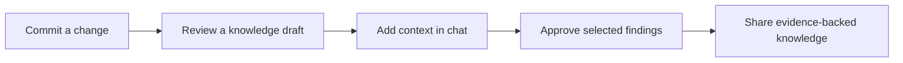

# Knect
### Knowledge + Connect

**Turn everyday code changes into shared understanding.**

Knect is a Meta-powered VS Code extension designed to help teams preserve the reasoning behind their work. It connects code changes with the decisions, experiments, failures, and precautions that other contributors need to understand a project.

When a developer commits a change, Knect prepares a proposed knowledge update. The developer reviews it, adds missing context through conversation, and approves what becomes part of the team’s shared memory. That knowledge remains connected to its author and supporting evidence, ready to help the next person working on the project.

> **Project status:** Design and specification stage. The extension has not yet been implemented.

## Why Knect

A repository records what changed, but it rarely captures the complete explanation. Why was an approach abandoned? Which experiment justified a decision? What failed before, and under which conditions? These details often remain in conversations or individual memory.

When that context disappears, contributors repeat investigations, misunderstand constraints, or unknowingly reintroduce old problems. Knect brings knowledge capture into the development workflow, while the person making the change still remembers the reasoning.

## From a commit to shared knowledge

After a commit in an enabled repository, Knect offers a review notification. Its panel presents the proposed findings, supporting code references, and questions that need clarification. The developer can correct an interpretation, explain a trade-off, approve individual findings, or leave the review for later.

Conversation refines the draft; explicit approval publishes it. Git commits and pushes continue normally, and unapproved proposals remain outside the team’s shared knowledge.

## Capture the explanation that code cannot provide

Consider a change that reduces retries from five attempts to two. The code shows the modification, but it does not establish the motivation.

Knect might ask:

> “What problem led to reducing the retry limit?”

The developer explains:

> “Timed-out requests were sometimes creating duplicate jobs. We reduced retries to limit repeated execution while investigating the underlying issue.”

Knect incorporates that explanation, links it to the commit, and presents the revised finding for approval. It preserves the distinction between an observable code change, the contributor’s explanation, and a conclusion that still needs experimental evidence.

## Make individual findings useful to the whole team

Contributors can share technical notes, experimental results, decisions, and warnings within a common workspace. Knect connects related contributions and compares their conditions before treating different results as a contradiction.

A developer investigating a component can ask why a particular approach was chosen. A newcomer can request a focused handover covering important files, accepted decisions, known failures, and unresolved questions. Answers point back to the evidence so contributors can inspect the reasoning themselves.

When later changes affect published guidance, Knect flags it for review. Revised conclusions preserve their history, allowing the team to understand both the current recommendation and how it developed.

## Work where the context already exists

Knect’s primary interface lives inside VS Code. A sidebar provides access to shared knowledge and pending reviews, while a dedicated panel supports discussion, evidence inspection, and approval. Relevant warnings and decisions remain accessible alongside the files they concern.

The first release is planned around a local knowledge service with separate authenticated contributor sessions. Hosted access for teams working from different locations is a later extension.

## Improve through feedback without losing accountability

Approved corrections can inform future proposals when they are relevant to the same task or component. Contributors can also explicitly approve reusable team guidance, helping Knect avoid repeating known misunderstandings.

This feedback improves the project’s available context; it does not imply automatic retraining of the underlying model. Findings retain their scope, attribution, and evidence, and incomplete information remains visible rather than being replaced with confident guesses.

## Keep contributors in control

Repository analysis is enabled explicitly. Selected source material is scanned and sanitized locally before being sent to Meta, and the developer reviews what will become visible to teammates.

Permission to use Meta for analysis and approval to publish knowledge are separate decisions. Human review remains central: Knect proposes interpretations, contributors supply missing reasoning, and authorized people decide what the team should retain.

---

**The code tells the team what changed. Knect helps them understand why it matters.**

See [PLAN.md](PLAN.md) for the architecture, development milestones, evaluation strategy, and operating constraints.