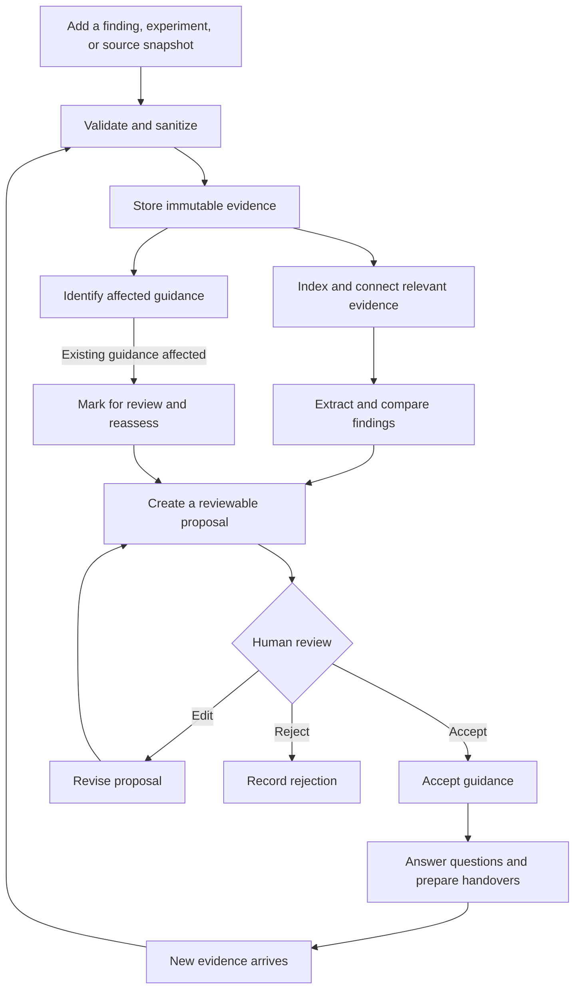
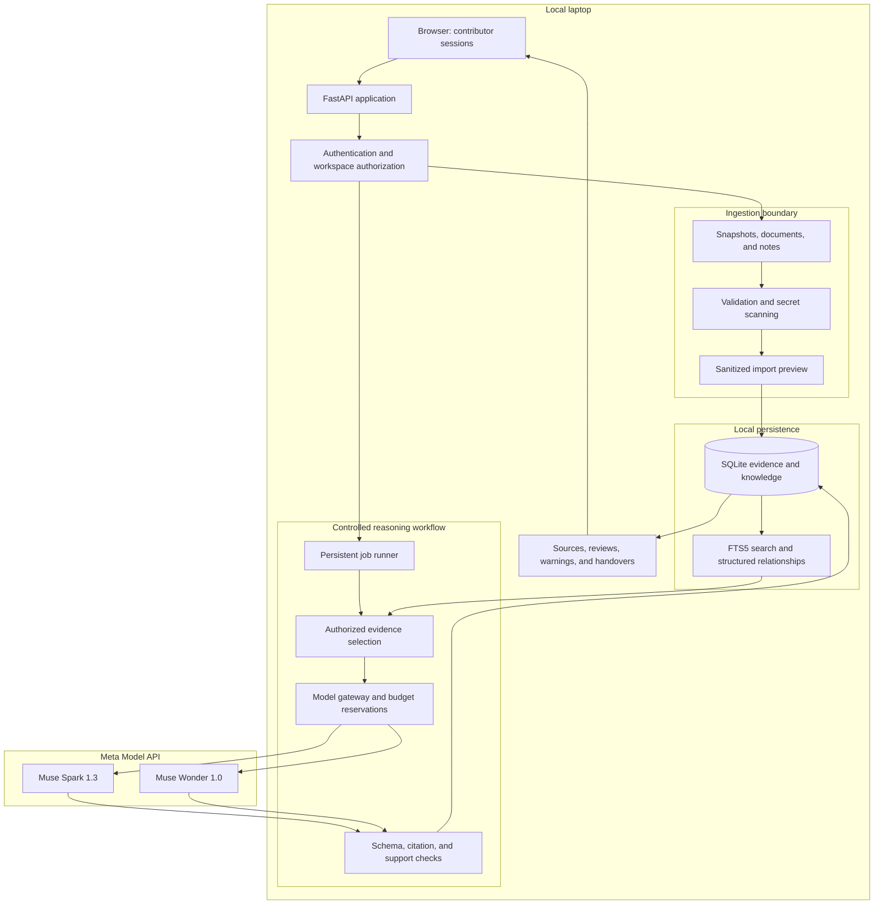
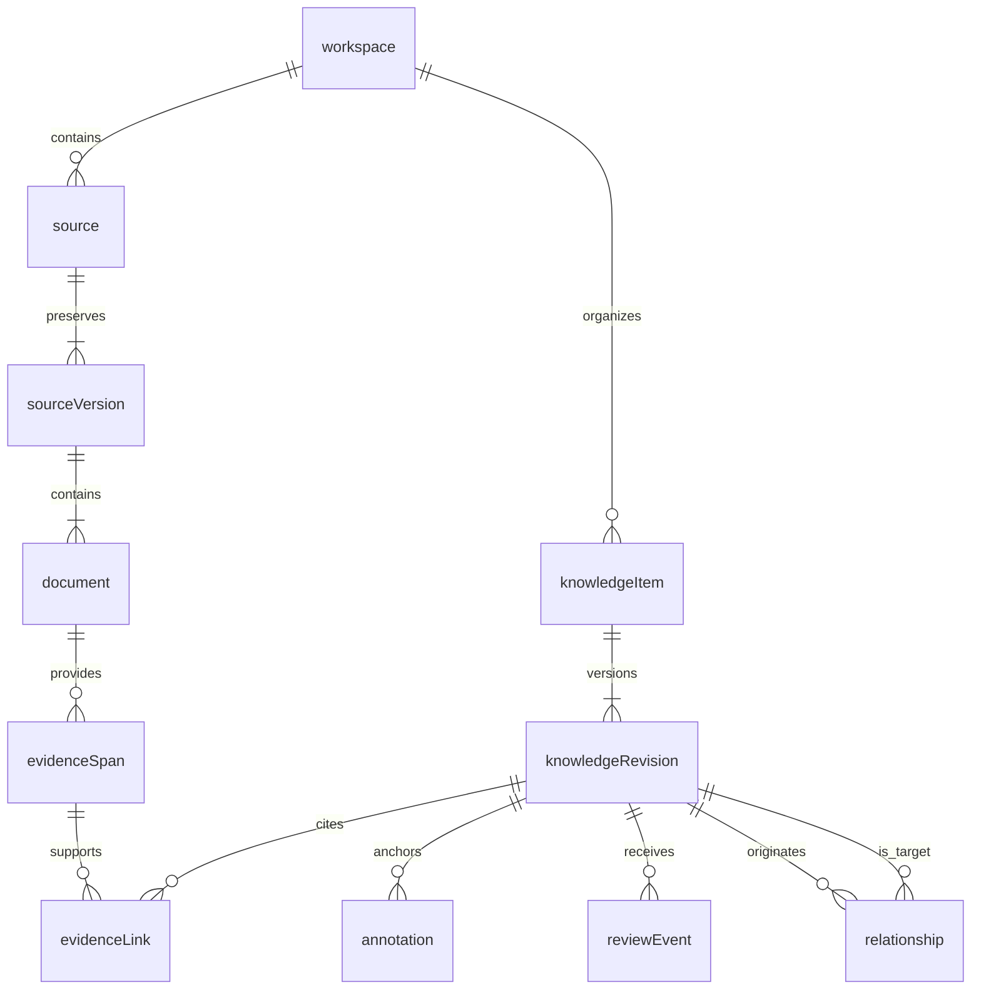
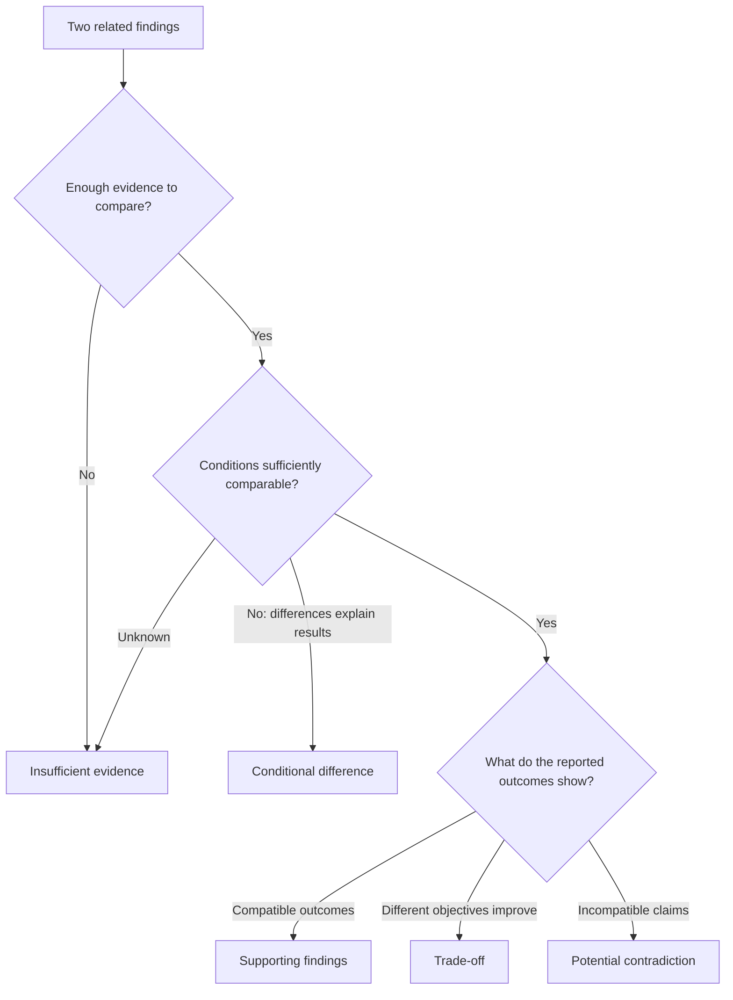
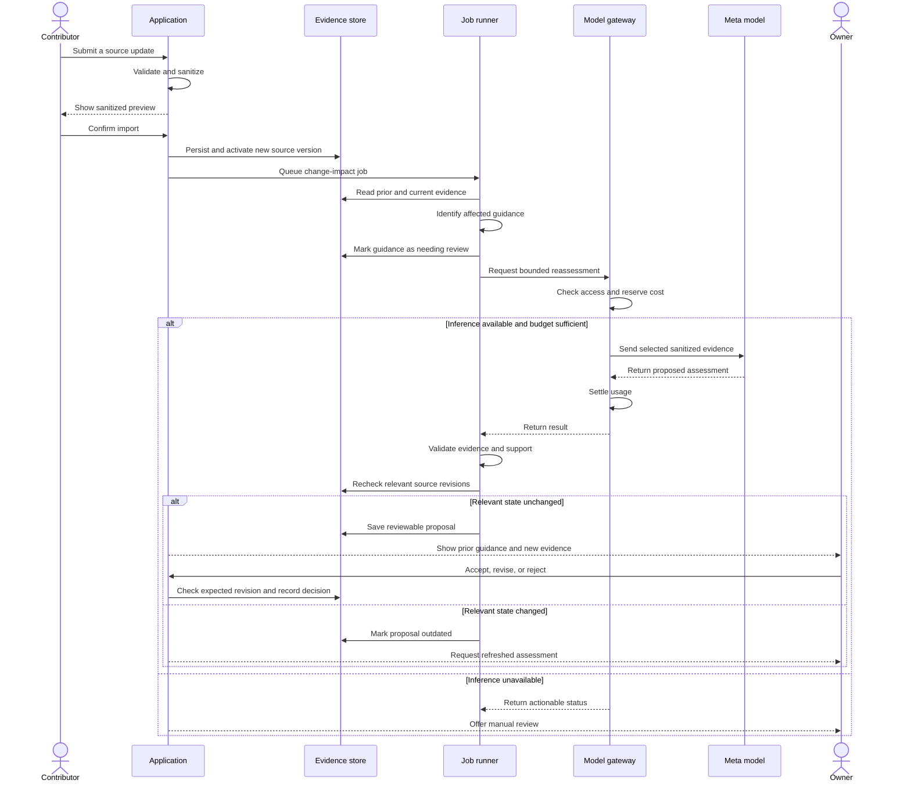

# Knect

## Knowledge + Connect

### Connect the knowledge. Preserve the why.

**A Meta-powered workspace that connects technical findings, decisions, experiments, and warnings to their evidence—and helps teams reassess that knowledge as their projects evolve.**

---

## Project Status

**Architecture and product specification. Development has not started.**

This README defines the proposed product, architecture, workflows, interfaces,
evaluation approach, and future development milestones.

Application coding, installation, and deployment begin only after the design
has been reviewed and approved.

Performance figures and evaluation thresholds in this document are targets or
explicitly labeled estimates, not measured results.

| Item | Decision |
|---|---|
| Project name | Knect |
| Name meaning | Knowledge + Connect |
| Hackathon | Meta Global AI Developer Hackathon 2026 |
| Project theme | Build for Your World |
| Intended participant track | Indie developer, subject to registration |
| Primary users | Small software teams, researchers, and technical collaborators |
| Initial operating environment | One laptop |
| Collaboration demonstration | Separate authenticated contributor sessions |
| AI inference | Meta Model API |
| Default model | Muse Spark 1.3 |
| Deeper comparison model | Muse Wonder 1.0 |
| Total available Meta credits | $150, subject to activation and account eligibility |
| Required paid infrastructure | None |
| Planning reference date | 26 October 2026 |

---

## Contents

1. Product Vision
2. Problem and Target Users
3. Product Principles
4. Complete User Journey
5. Release Scope
6. System Architecture
7. Technology Decisions
8. Evidence and Knowledge Model
9. Secure Ingestion
10. Retrieval and Evidence Selection
11. AI Workflows
12. Knowledge Freshness and Review
13. User Experience
14. API and Processing Contracts
15. Meta Model Strategy
16. Budget and Usage Controls
17. Security and Privacy
18. Reliability and Recovery
19. Evaluation and Acceptance
20. Future Development Plan
21. Demonstration and Submission
22. Limitations and Future Direction

---

# 1. Product Vision

Teams usually preserve their code more reliably than their reasoning.

A repository can show that a function changed without explaining:

- Why the previous implementation failed.
- Which experiment justified the replacement.
- Which hardware or dataset affected the result.
- Why a seemingly unnecessary constraint remains important.
- Whether an old warning still applies.
- What a new contributor should understand before modifying the component.

Knect preserves that context as evidence-backed project knowledge.

It connects contributions across repositories and people, compares findings
under their actual conditions, and helps maintain guidance when new evidence
arrives.

## The Product Promise

> A contributor should be able to understand what the team knows, why it believes
> it, where the evidence lives, and which conclusions need another look.

Knect should help answer four questions:

1. **What do we know about this component?**
2. **Why did we make these decisions?**
3. **Under which conditions does this guidance apply?**
4. **What needs review after the project changes?**

## What Makes the Product Valuable

The primary experience is a continuous lifecycle:

**Contribution → Evidence → Interpretation → Review → Knowledge transfer → New evidence → Reassessment**

Search and question answering support this lifecycle. They are not the entire
product.

The distinctive capability to evaluate is the combination of:

- Explicit experimental conditions.
- Evidence-linked technical reasoning.
- Cross-contributor comparison.
- Versioned guidance.
- Code-linked warnings.
- Reviewable updates after source changes.

Knect does not claim that shared context, retrieval, citations, or knowledge
graphs are individually new inventions.

---

# 2. Problem and Target Users

## Problems Addressed

| Problem | Consequence | Knect response |
|---|---|---|
| Knowledge is scattered | Contributors repeatedly reconstruct context | Collect contributions in one workspace |
| Decisions lose their reasoning | Later changes repeat earlier mistakes | Preserve rationale with evidence |
| Findings appear contradictory | Teams choose inappropriate conclusions | Compare conditions before classifying disagreement |
| Warnings become stale | Contributors follow outdated guidance | Flag guidance affected by new evidence |
| Onboarding depends on individuals | Knowledge transfer is slow and inconsistent | Generate focused, cited handovers |
| Sensitive material enters documentation | Credentials or confidential context may leak | Scan, sanitize, and control access before inference |

## Initial Audience

Knect targets small technical teams working with a few repositories and a
manageable volume of project knowledge.

Representative users include:

- Hackathon collaborators.
- Student software teams.
- Open-source maintainers.
- Researchers comparing experiments.
- Small engineering teams handing work between contributors.

Large enterprise deployments and organization-wide integrations are outside
the first release.

## User Roles

### Owner

Creates the workspace, manages membership, reviews guidance, and controls
external inference.

### Contributor

Imports sources, records findings, attaches warnings, and proposes updates.

### Viewer

Searches evidence, asks questions, and generates handovers without changing
shared knowledge.

The initial demonstration uses separate authenticated sessions on one device.
It does not require several computers.

---

# 3. Product Principles

## Evidence Before Conclusions

Substantive technical statements must point to inspectable source material.

A generated explanation is an interpretation. It is not an independent source.

## Conditions Before Contradictions

Two findings may differ because they concern different datasets, hardware,
versions, metrics, or workloads.

Missing conditions remain missing. They are not silently assumed equal.

## Human Review Before Shared Guidance Changes

Models can propose interpretations and updates.

Only authorized people can accept shared guidance or supersede an accepted
decision.

## History Before Overwriting

A revised conclusion preserves the previous interpretation, its evidence, and
the reason for the update.

## Bounded AI Work

Each model call has a defined task, evidence set, output structure, cost limit,
and failure behavior.

No open-ended autonomous agents are required.

## Local Operation with Explicit External Inference

Storage, retrieval, validation, and the interface run locally.

Selected sanitized evidence is sent to Meta for reasoning. The interface makes
that boundary visible.

## Small Architecture, Complete Product

Dependencies must support an essential capability.

The release avoids infrastructure that does not materially improve the
knowledge lifecycle.

---

# 4. Complete User Journey

## Example: A Retrieval Service

A team maintains two repositories:

- A retrieval engine.
- An API service using that engine.

One contributor reports that dense retrieval improves relevance. Another finds
that keyword retrieval performs better on a different evaluation set.

A third contributor records that a preprocessing change previously broke
identifier matching.

Knect should:

1. Import the repository snapshots and contributor records.
2. Preserve the conditions of each experiment.
3. Recognize that different datasets may explain the apparent disagreement.
4. Present an evidence-backed comparison.
5. Let the maintainer accept conditional guidance.
6. Attach the preprocessing warning to the relevant file.
7. Generate an onboarding handover containing the decision and warning.
8. Detect that a replacement snapshot affects the warning.
9. Propose a reassessment.
10. Preserve the old guidance when a reviewed revision replaces it.

## Knowledge Lifecycle Diagram



## Definition of End-to-End Completion

This entire workflow must operate through the interface, persist across
restarts, and work with the final Meta configuration.

Independent demonstrations of ingestion, chat, and comparison do not satisfy
the release requirement unless they share the same evidence and review state.

---

# 5. Release Scope

## Required Capabilities

- Persistent workspaces and memberships.
- Owner, contributor, and viewer roles.
- Multiple repository snapshot imports.
- Markdown and plain-text document imports.
- Structured findings, experiments, decisions, and warnings.
- Local secret detection and sanitized import preview.
- Search over authorized evidence.
- AI-assisted extraction from selected material.
- Condition-aware comparison of findings.
- Acceptance, revision, and rejection of proposed guidance.
- File-linked warnings.
- Replacement snapshots and change-impact detection.
- Evidence-backed answers.
- Focused onboarding handovers.
- Markdown handover export.
- Job progress and actionable errors.
- Model attribution and usage accounting.
- Reproducible fixtures and evaluation cases.

## Explicitly Excluded

- Git hosting and repository editing.
- Autonomous code modification.
- GitHub OAuth, webhooks, and continuous synchronization.
- IDE extensions.
- Real-time collaborative editing.
- Arbitrary URL fetching or web crawling.
- PDF, image, audio, and video ingestion.
- Comprehensive static analysis.
- Automatic extraction of a complete dependency graph.
- Dedicated graph or vector databases.
- Fine-tuning or model training.
- Public SaaS hosting, payments, and enterprise identity.
- Document-specific access rules within one workspace.

## Initial Operating Limits

| Resource | Limit |
|---|---:|
| Repository groups per workspace | 3 |
| Demonstration accounts | 3 |
| Files per repository snapshot | 1,000 |
| Compressed ZIP size | 20 MB |
| Expanded snapshot size | 50 MB |
| Individual accepted text file | 1 MB |
| Active indexed chunks per workspace | 10,000 |
| Concurrent external inference requests | 1 |

These limits are product boundaries for the first release, not measured
hardware capacity.

Inputs exceeding a limit receive a clear rejection or require an explicitly
smaller selection. Partial coverage must always be visible.

---

# 6. System Architecture

## Deployment Model

The application runs on one laptop:

- A browser provides the interface.
- FastAPI owns application behavior.
- SQLite stores evidence and application state.
- A persistent job runner performs ingestion and AI work.
- Meta Model API performs all model inference.

During development, Vite serves the frontend.

For the demonstration, the frontend is built into static assets served by
FastAPI, producing one application server.

## Architecture Diagram



## Backend Responsibilities

The backend exclusively controls:

- Membership and permissions.
- Source validation and sanitation.
- Evidence identifiers and source versions.
- Retrieval.
- Model requests.
- Budget enforcement.
- Output validation.
- Review transitions.
- Audit history.

Provider credentials never reach the browser.

## Background Processing

Use a durable jobs table and one application-managed worker.

Do not add Redis, Celery, a message broker, or a separate worker service.

A job records its inputs, source revisions, progress, attempts, result, and safe
error metadata.

Expensive operations are asynchronous. Ordinary evidence browsing and search
remain available while a job runs.

---

# 7. Technology Decisions

| Area | Selected technology | Reason |
|---|---|---|
| Interface | React and TypeScript | Interactive evidence review and consistent state handling |
| Frontend build | Vite | Simple development and static production assets |
| Styling | Tailwind CSS | Consistent layout and accessible states |
| Backend | Python 3.12 and FastAPI | Typed APIs and straightforward workflow orchestration |
| Validation | Pydantic | Explicit input and output contracts |
| Persistence | SQLite through the Python standard library | Local durability without a database service |
| Search | SQLite FTS5 | Ranked text search and exact technical terms |
| Relationship lookup | Relational tables | Explicit evidence links without a graph database |
| Secret detection | Gitleaks CLI | Established local detection tooling |
| Model transport | HTTPX | Direct control over Meta requests, limits, and errors |
| Backend tests | pytest | State, security, retrieval, and budgeting checks |
| Browser tests | Playwright | Complete contributor workflows |

## Why No Separate Embedding Model?

The release uses:

- Local keyword retrieval.
- Exact identifier and path matching.
- Contributor-defined components and conditions.
- Explicit evidence relationships.
- Bounded Meta-assisted query expansion when needed.

This keeps all model inference within Meta and avoids a second model runtime,
large local dependencies, and vector-index synchronization.

The trade-off is weaker retrieval for some paraphrases. Evaluation must measure
that weakness rather than assume query expansion eliminates it.

## Why No Agent Framework?

The workflows have known steps and clear authority boundaries.

Ordinary application functions and a durable job runner are sufficient.
A framework that adds autonomous planning, memory, and tool orchestration
would duplicate behavior the application must already control.

## Database Operation

- Enable foreign keys on every connection.
- Use parameterized SQL.
- Use short transactions.
- Never hold a transaction during inference.
- Use bounded handling of temporary lock contention.
- Store the database on a local disk outside synchronized folders.
- Use SQLite's default rollback journal for the initial release.
- Apply numbered SQL migrations transactionally.

One writer and short transactions are sufficient for the initial local
collaboration workload.

---

# 8. Evidence and Knowledge Model

## Evidence Versus Interpretation

**Evidence** is immutable sanitized source material.

**Knowledge** is a versioned statement or interpretation linked to evidence.

A generated summary is not promoted into primary evidence.

## Core Records

| Record | Main fields |
|---|---|
| Workspace | ID, name, description, owner, knowledge revision |
| User | ID, display name, credential hash |
| Membership | User ID, workspace ID, role |
| Source | Workspace, type, repository or document identity |
| Source version | Source ID, sanitized content hash, timestamp, importer |
| Document | Source version, normalized path, sanitized text, content hash |
| Evidence span | Document, character offsets, line range, excerpt hash |
| Chunk | Document, evidence span, text, search metadata |
| Knowledge item | Stable ID, workspace, kind, component, author |
| Knowledge revision | Statement, conditions, evidence links, review state, freshness |
| Relationship | Origin revision, target revision, type, evidence, review state |
| Annotation | Knowledge revision, path, anchor, location state |
| Review event | Reviewer, decision, rationale, affected revision, timestamp |
| Job | Task, input revisions, status, progress, attempts, result |
| Model run | Model, task, prompt version, evidence IDs, usage, outcome |
| Budget reservation | Job/run, reserved cost, settlement state |
| Audit event | Actor, action, affected IDs, timestamp, safe metadata |

Use UUIDs for application identities and content hashes for duplicate detection.

## Evidence Relationship Diagram



## Knowledge Types

- Finding.
- Experiment.
- Decision.
- Warning.
- Limitation.
- Open question.

## Conditions

Where relevant, record:

- Component.
- Dataset or workload.
- Method and configuration.
- Hardware.
- Software or source version.
- Metric and direction.
- Measurement and unit.
- Sample size or number of runs.
- Observation date.
- Additional limitations.

Unknown fields remain `null` or “not reported.”

Numeric values, units, and dates explicitly entered in forms are preserved
directly. A model must not silently replace them.

## Independent Status Dimensions

### Review

- `proposed`
- `accepted`
- `rejected`

### Freshness

- `current`
- `needs_review`
- `historical`

### Annotation location

- `attached`
- `relocated`
- `unresolved`

“Accepted” means reviewed by a person.

“Current” means no known unresolved change against the imported evidence.

Neither status guarantees objective correctness.

## Provenance

Every substantive technical conclusion must identify:

- Source.
- Immutable source version.
- Document or note.
- Exact supporting span.
- Contributor or importer.
- Relevant observation and import timestamps.
- Review and freshness state.

A user-entered commit hash is recorded as reported metadata. It is not treated
as a verified Git identity.

For manually imported snapshots, the sanitized snapshot content hash is the
authoritative application identity.

## Revision and Deletion

- Editing a note creates a new source version.
- Revising guidance creates a new knowledge revision.
- Supersession preserves the earlier revision.
- Historical evidence is excluded from ordinary current-state retrieval unless
  needed to explain a warning or requested explicitly.
- Deleting a source removes its retrievable content and invalidates dependent
  generated results.
- Audit records retained after deletion contain metadata, not deleted content.

---

# 9. Secure Ingestion

## Supported Inputs

1. ZIP repository snapshots.
2. Markdown files.
3. Plain-text files.
4. Contributor notes.
5. Structured experiment forms.

No imported code is executed.

## Import Process

1. Validate request size and input type.
2. Inspect archive entries.
3. Enforce path and expansion limits.
4. Exclude unsupported and sensitive file classes.
5. Scan accepted text locally.
6. Redact affected content.
7. Present a sanitized preview and coverage report.
8. Obtain contributor confirmation.
9. Store immutable sanitized evidence.
10. Build search chunks.
11. Activate the source version atomically.
12. Queue freshness checks.

Until confirmation and successful indexing, the new source version remains
staged.

The previous active version remains available if the import fails.

## Archive Validation

Reject:

- Absolute paths.
- Parent traversal.
- Drive-qualified and alternate data stream paths.
- Symlinks.
- Ambiguous normalized paths or case collisions.
- Encrypted archives.
- Nested archives.
- Excessive compression ratios.
- Entry counts or expanded sizes above the configured limits.

Count actual expanded bytes while reading. Archive metadata alone is not
trusted.

## Default Exclusions

- `.git`.
- Dependency directories.
- Virtual environments.
- Build output and generated assets.
- `.env*`.
- Private keys and credential stores.
- Binary files and databases.
- Model weights and media.
- Unsupported encodings.
- Files that cannot be scanned successfully.

The import report identifies what was included, skipped, redacted, or blocked.

## Secret Detection and Redaction

Use application-controlled Gitleaks configuration.

Uploaded repositories must not override scanner rules through their own
configuration files, ignore lists, or inline allow directives.

For the initial release:

- Redact entire affected lines while preserving newline count.
- Remove complete private-key blocks if encountered.
- Block content whose findings cannot be mapped safely.
- Store only sanitized source text.
- Remove temporary raw uploads after processing or cancellation.
- Clean abandoned temporary uploads on startup.
- Avoid raw source, prompt, and credential logging.

Gitleaks output redaction does not automatically sanitize application source
storage. The application must perform that transformation itself.

Scan notes, questions, and metadata as well as uploaded files.

Recheck outbound text before model inference and scan generated text before
display.

If the scanner is unavailable, fail closed for ingestion and external
inference.

## Privacy Boundary

All sources within a workspace share the same membership boundary.

Document-level restrictions are not supported in this release. Material that
requires different access must be placed in another workspace or excluded.

Use synthetic or deliberately shareable material for development and recording.

---

# 10. Retrieval and Evidence Selection

## Search Representation

Split source material into line-preserving windows:

- Prefer headings and paragraph boundaries.
- Target a maximum of approximately 2,000 characters per chunk.
- Use a small overlap, capped at 200 characters.
- Split unusually long lines using exact character offsets.
- Preserve path, component, source version, and evidence-span identifiers.

Index only sanitized material.

## Retrieval Pipeline

1. Authenticate the session.
2. Resolve workspace membership.
3. Select authorized active source versions.
4. Search the original question using FTS5.
5. Add exact path and identifier matches.
6. Include linked accepted decisions and warnings.
7. If evidence is absent or sparse, optionally request up to three search
   formulations from Muse Spark.
8. Search those formulations locally.
9. Combine ranked lists using reciprocal rank fusion with `k = 60`.
10. Expand explicit evidence relationships by at most one hop.
11. Deduplicate overlapping spans.
12. Select at most 12 evidence windows within the task input budget.

For this workflow, “sparse” means fewer than four distinct evidence spans after
the initial retrieval. Query expansion also remains available as an explicit
user action.

Retrieve up to 30 matches per search formulation.

## Query Expansion Rules

The model may propose:

- Alternative technical terms.
- Related identifiers.
- Component-specific search phrases.

It cannot fetch external information or create evidence.

The application converts suggestions into safely escaped search terms. It does
not execute arbitrary model-generated SQL or unrestricted FTS expressions.

## Important Guidance

Relevant accepted warnings and decisions are included even when they are not
the highest-ranked text matches.

Guidance marked `needs_review` may be included, but must carry that status into
the final answer.

## Search Limitations

Keyword retrieval can miss paraphrases and ambiguous terminology.

Query expansion can also miss useful sources or introduce poor search terms.

Measure evidence recall using labeled cases. Never describe a search score as
a probability that an answer is correct.

---

# 11. AI Workflows

## 11.1 Structured Extraction

Run extraction on:

- Contributor notes.
- Experiment records.
- Explicitly selected document sections.

Do not automatically generate claims for every repository function.

Each extracted proposal includes:

- Statement.
- Knowledge type.
- Component.
- Conditions.
- Supporting evidence spans.
- Missing information.
- Short applicability explanation.

Limit one extraction job to 20 selected evidence windows and 40 proposals.

Any excess selection remains visibly unprocessed.

Structured form values bypass unnecessary extraction. The model interprets
context rather than rediscovering fields already supplied by the contributor.

## 11.2 Condition-Aware Reconciliation

For each selected finding:

1. Retrieve related knowledge.
2. Select at most five comparison candidates.
3. Compare reported conditions.
4. Generate a relationship classification.
5. Check evidence and numeric consistency.
6. Present a reviewable comparison.

Limit one job to ten comparison groups.

### Classification

| Result | Meaning |
|---|---|
| `supports` | Findings align under sufficiently comparable conditions |
| `conditional_difference` | Reported conditions explain the apparent disagreement |
| `tradeoff` | Different choices improve different relevant outcomes |
| `contradiction` | Claims conflict under sufficiently comparable conditions |
| `insufficient_evidence` | Missing details prevent a defensible comparison |

### Comparison Decision Diagram



Every comparison must cite both sides.

A proposed contradiction does not declare that one contributor is wrong. It
identifies the unresolved disagreement and any missing checks.

## 11.3 Questions

Answers contain:

- Direct response.
- Evidence-backed statements.
- Applicable conditions.
- Relevant warnings.
- Disagreements.
- Missing information.
- Citations.
- Review and freshness qualifiers.

The answer status is:

- `supported`
- `partial`
- `insufficient_evidence`

If the evidence does not support a conclusion, the system says so.

## 11.4 Handovers

Support two initial audiences:

- New contributor.
- Maintainer.

A handover includes:

1. Component purpose.
2. Relevant files and responsibilities.
3. Accepted decisions and rationale.
4. Findings and trade-offs.
5. Historical failures and warnings.
6. Guidance needing review.
7. Open questions.
8. Suggested next checks.
9. Evidence references.

Suggested checks are clearly distinguished from established project
requirements.

## 11.5 Output Validation

Deterministic checks verify:

- JSON structure and enum values.
- Evidence identifier existence.
- Workspace access.
- Source versions and valid offsets.
- Exact quoted text.
- Structured numeric consistency.
- Referenced paths.
- Output secret scanning.

Synthesized answers and comparisons receive a separate bounded support-checking
call.

That call checks whether statements follow from their cited evidence and retain
necessary conditions.

It is an additional model check, not independent proof.

Unsupported statements are removed, qualified, or replaced by an explicit
insufficient-evidence response.

An invalid citation is never repaired by attaching an unrelated source.

## 11.6 Bounded Calls

| Workflow | Maximum calls |
|---|---:|
| Answer or handover without query expansion | 3 |
| Answer or handover with query expansion | 4 |
| Extraction batch | 2 |
| Comparison group | 4, including any escalation |

Answer calls cover synthesis, support checking, and at most one repair.

Comparison calls cover classification, support checking, and either a repair
or one Wonder escalation followed by its support check.

A failed validation after the allowed calls produces a clear failure or
insufficient-evidence result.

---

# 12. Knowledge Freshness and Review

## Change Detection

A replacement source version triggers deterministic checks:

1. Compare file identities and content hashes.
2. Identify added, changed, and removed files.
3. Find directly dependent evidence spans and annotations.
4. Mark affected guidance `needs_review`.
5. Attempt safe location reattachment.
6. Generate reassessment proposals for selected affected items.

Automatic freshness detection only covers explicit links and supported change
signals. It does not establish complete knowledge of all behavioral
dependencies.

## Stable Annotations

Store:

- Source identity and version.
- File path.
- Exact selected text.
- Text fingerprint.
- Character offsets.
- Displayed line range.
- Surrounding context.
- Linked knowledge revision.

### Reattachment Rules

| Situation | Action |
|---|---|
| File unchanged | Preserve location |
| Anchor appears exactly once at the same path | Relocate location |
| Entire file moved and its hash matches uniquely | Relocate and record the move |
| Anchor appears multiple times | Mark unresolved |
| Anchor changed or disappeared | Mark unresolved |
| File removed | Preserve historical evidence and request review |

Relocation and freshness are separate.

If the file changed, the guidance still requires review even when its selected
text remains unchanged.

Do not silently relocate annotations using fuzzy similarity.

## Review Actions

An owner can:

- Accept a proposal.
- Edit and accept a new revision.
- Reject with a reason.
- Confirm that prior guidance still applies.
- Mark guidance historical.
- Supersede it with a new accepted revision.

A model cannot approve its own proposal.

## Update Sequence



## Optimistic Concurrency

Review requests include the expected revision.

If the relevant knowledge or evidence changed after the reviewer opened the
proposal, return a conflict and require refreshed review.

A code change alone does not prove a historical failure has been fixed. The
system may request a new experiment instead of proposing removal of a warning.

---

# 13. User Experience

## Workspace Overview

Show:

- Project purpose.
- Sources and snapshot dates.
- Accepted decisions.
- Active warnings.
- Guidance needing review.
- Recent contributions.
- Provider availability.
- Remaining application budget.

An AI-generated overview includes citations and its generation timestamp.

## Sources

Provide:

- Repository and document navigation.
- Sanitized source text.
- Line numbers.
- Version history.
- Import coverage.
- Linked warnings and decisions.
- Side-by-side changed evidence.

## Knowledge and Reviews

Each knowledge card shows:

- Statement.
- Component.
- Conditions.
- Author.
- Review state.
- Freshness state.
- Evidence.

A review screen places prior guidance, new evidence, missing information, and
the proposed revision together.

## Ask and Handover

Provide:

- Question field.
- Component filter.
- Handover audience.
- Expandable evidence.
- Clearly marked uncertainty.
- Stale-guidance notices.
- Markdown export.

## Activity and Usage

Show:

- Job status.
- Review activity.
- Model attribution.
- Token usage.
- Estimated and settled cost.
- Remaining allowance.
- Actionable failures.

## Accessibility

- Full keyboard access.
- Visible focus.
- Labels in addition to color.
- Sufficient contrast.
- Accessible progress and error announcements.
- Layout suitable for a normal laptop display.

Evidence cards and comparison tables are the primary presentation.
An interactive graph is not required.

---

# 14. API and Processing Contracts

All application routes use `/api/v1`.

## Principal Routes

| Method and route | Purpose |
|---|---|
| `POST /sessions` | Authenticate |
| `DELETE /sessions/current` | Log out |
| `POST /workspaces` | Create a workspace |
| `GET /workspaces/{id}` | Read authorized workspace state |
| `POST /workspaces/{id}/members` | Add a local member |
| `PATCH /workspaces/{id}/members/{user_id}` | Change role |
| `DELETE /workspaces/{id}/members/{user_id}` | Revoke membership |
| `POST /workspaces/{id}/imports` | Stage and validate an upload |
| `POST /imports/{id}/confirm` | Confirm sanitized content |
| `POST /sources/{id}/versions` | Stage a replacement snapshot |
| `POST /workspaces/{id}/notes` | Create a note or experiment |
| `POST /notes/{id}/versions` | Revise a note |
| `POST /workspaces/{id}/annotations` | Attach guidance to evidence |
| `POST /workspaces/{id}/analyses` | Extract or compare selected knowledge |
| `GET /workspaces/{id}/search` | Search authorized evidence |
| `POST /workspaces/{id}/answers` | Generate an answer |
| `POST /workspaces/{id}/handovers` | Generate a handover |
| `GET /evidence/{id}` | Inspect cited evidence |
| `POST /knowledge/{id}/reviews` | Apply an authorized review |
| `GET /jobs/{id}` | Read job state |
| `POST /jobs/{id}/cancel` | Request cancellation |
| `GET /handovers/{id}/export` | Export Markdown |
| `GET /workspaces/{id}/usage` | Read usage and budget |
| `DELETE /sources/{id}` | Remove source content and invalidate dependents |

Every object route checks workspace membership.
Knowing an identifier does not grant access.

## Asynchronous Operations

Indexing and model-backed operations return `202 Accepted` with a `job_id`.

States:

`queued → running → succeeded | failed | cancelled | needs_reconciliation`

The interface polls active jobs every second, with backoff for long operations.

Cancellation prevents subsequent workflow steps. It does not imply that an
already submitted provider request was cancelled or unbilled.

## Answer Record

An answer contains:

- Status.
- Structured sections.
- Statement-to-evidence mappings.
- Warnings.
- Missing evidence.
- Source and knowledge revisions.
- Model and prompt version.
- Usage.
- Generation timestamp.
- Validation outcomes.

Citations are rendered from validated application identifiers.
Model-authored arbitrary links do not become trusted citations.

## Errors

| Condition | Behavior |
|---|---|
| Invalid fields | `422` with useful field errors |
| Oversized input | `413` |
| Unsupported format | `415` |
| Unauthorized object | `404` |
| Stale revision | `409` |
| Local request limit | `429` |
| Budget unavailable | Structured `budget_exhausted` result |
| Provider unavailable | Failed job with safe retry guidance |
| Insufficient evidence | Successful abstention result |

Do not expose raw provider errors, credentials, or internal filesystem paths.

---

# 15. Meta Model Strategy

## Model Assignment

| Task | Default model |
|---|---|
| Query expansion | `muse-spark-1.3` |
| Structured extraction | `muse-spark-1.3` |
| Answers and handovers | `muse-spark-1.3` |
| Support checks | `muse-spark-1.3` |
| Routine comparisons | `muse-spark-1.3` |
| Selected deeper comparisons | `muse-wonder-1.0` |

Use the Meta API base URL:

`https://api.meta.ai/v1`

Use Chat Completions and structured JSON output for the initial integration.

The public interface is a planning reference. Account access and current
capabilities must be checked when credits activate.

## Standard Mode

Use standard model variants by default.

Do not select Contributor-mode variants merely to reduce price. Such modes
have different data-use terms.

Do not assume a coding subscription, hosted partner endpoint, or self-hosted
GPU is covered by the Meta API credits.

## Wonder Escalation

Allow deeper comparison only when:

- An owner explicitly requests it; or
- The available evidence is sufficient, but a Spark comparison remains
  unresolved after support checking.

Missing evidence is not a reason to spend more inference.

Allow one Wonder escalation per comparison group and record its incremental
cost and effect.

## Request Contract

Each request records:

- Task type.
- Model.
- Prompt version.
- Output schema version.
- Evidence IDs.
- Input limit.
- Completion limit.
- Reasoning configuration.
- Timeout.
- Provider request ID when available.
- Usage and outcome.

## Initial Token Budgets

| Task | Target input ceiling | Completion ceiling |
|---|---:|---:|
| Query expansion | 2,000 | 1,024 |
| Extraction | 4,000 | 4,096 |
| Answer or handover | 8,000 | 8,192 |
| Support check | 6,000 | 4,096 |
| Deeper comparison | 12,000 | 8,192 |

Completion ceilings include reasoning and visible output where required by the
API.

Input estimates must not be presented as exact provider token counts unless
verified with a supported tokenizer or counting mechanism.

Start with low reasoning effort for extraction and search formulation, and
medium effort for synthesis and comparison. Confirm supported settings during
the provider contract test.

## Capability Contract Tests

Before integrating live inference into the main workflow, verify:

- Authentication.
- Model access.
- Structured output.
- Completion limits.
- Usage reporting.
- Refusal and empty-output handling.
- Timeout behavior.
- Rate-limit behavior.

Before credit activation, local workflows use deterministic test fixtures.
Fixture responses must never be represented as live model results.

## GPU Position

The first release requires no local GPU.

Self-hosted Muse Glimmer is outside the delivery path. Available H100 access
does not create a requirement to use it.

---

# 16. Budget and Usage Controls

## Financial Constraint

The total Meta allowance is **$150**.

Normal planned spending is capped at **$115**.
Controlled contingency can raise application spending to **$135**.
The final **$15 remains unused** as a safety margin.

No paid hosting or GPU rental is required.

## Public Reference Rates

Planning rates checked on 26 October 2026:

| Model | Input per million tokens | Output per million tokens |
|---|---:|---:|
| Muse Spark 1.3, standard | $1.25 | $4.25 |
| Muse Wonder 1.0, standard | $4.00 | $20.00 |

These rates do not confirm credit eligibility for a particular account.

Recheck rates, balance, expiration, and eligible models before the first billable
request. Budget without assuming cached-input discounts.

## Allocation

| Purpose | Ceiling |
|---|---:|
| Provider integration and contract tests | $15 |
| Extraction and retrieval experiments | $15 |
| Reconciliation and freshness experiments | $20 |
| Evaluation and regressions | $30 |
| Interactive testing | $15 |
| Rehearsal and final demonstration | $20 |
| Controlled contingency | $20 |
| Untouched safety margin | $15 |
| **Total** | **$150** |

These are maximum allocations, not spending targets.

## Illustrative Usage

Assuming the following average token counts:

| Workload | Calls | Input per call | Billed output per call | Estimated cost |
|---|---:|---:|---:|---:|
| Spark extraction | 200 | 4,000 | 3,000 | $3.55 |
| Spark query planning | 100 | 2,000 | 1,000 | $0.68 |
| Spark answers and handovers | 150 | 8,000 | 5,000 | $4.69 |
| Spark support checks | 200 | 6,000 | 2,000 | $3.20 |
| Wonder comparisons | 50 | 12,000 | 8,000 | $10.40 |
| **Total** | **700** | — | — | **$22.51** |

The total is calculated before rounding individual rows.

Three equivalent workloads would cost approximately **$67.54**.

This is a feasibility illustration, not a usage forecast. Actual reasoning
tokens, retries, and unsuccessful billable requests must be accounted for.

## Reservation and Settlement

All billable calls, including experiments and evaluations, pass through the same
gateway.

Before a request:

1. Check pricing and account eligibility.
2. Estimate input cost conservatively.
3. Reserve maximum completion cost.
4. Add estimation headroom.
5. Check task and global budgets atomically.
6. Reject the request if funds are insufficient.

After a request:

- Settle against reported usage.
- Include reasoning tokens as required by the provider.
- Count retries.
- Retain reservations for uncertain billing outcomes.
- Reconcile ambiguous requests before retrying.

Never automatically replay a request after an ambiguous timeout.

## Hard Spending Boundary

Application estimates alone cannot guarantee account-level spending.

Billable inference remains disabled until one of the following is confirmed:

- The account cannot spend beyond prepaid credits; or
- A provider-enforced limit prevents spending above the remaining authorized
  allowance.

Disable automatic recharge.

Reconcile application totals with the provider dashboard daily and before
recording. Include any account usage outside the application.

## Budget Degradation

When inference is unavailable or the budget is exhausted:

- Keep local search operational.
- Preserve evidence browsing.
- Allow manual contribution and review.
- Display existing outputs with their timestamps.
- Explain why new generation is unavailable.

Do not silently switch to another paid service.

---

# 17. Security and Privacy

## Authentication

Use local accounts with randomly generated initial credentials.

Store salted password hashes, never plaintext passwords.

Use server-managed sessions with:

- HttpOnly cookies.
- SameSite protection.
- Origin checks for state-changing requests.
- Expiration and logout.
- Login throttling.

Bind the application to `127.0.0.1` by default.

Remote exposure is outside this release.

## Authorization

Apply workspace access checks to:

- Search.
- Evidence.
- Model jobs.
- Cached results.
- Reviews.
- Exports.
- Source deletion.
- Usage information.

A demonstration persona selector must not bypass authorization.
Use separate browser profiles or isolated browser sessions.

## Prompt Injection

Treat all imported content as untrusted data.

- Keep evidence separate from higher-priority model instructions.
- Do not execute embedded commands.
- Do not expose credentials to the model.
- Do not allow arbitrary external requests.
- Do not allow model-authored database writes.
- Validate evidence references.
- Require human review for shared knowledge changes.

The main safeguard is limited model authority.

## Rendering

- Escape source text.
- Disable raw HTML in contributed and generated Markdown.
- Reject dangerous link schemes.
- Avoid embedded remote resources.
- Render evidence links from trusted application IDs.

## Logging

Operational logs may contain:

- Job and run IDs.
- Durations.
- Safe error codes.
- Model IDs.
- Token totals.
- Cost totals.
- Content hashes.

They must not contain raw source content, prompts, credentials, or detected
secret values.

## Storage Boundary

The application does not provide application-level encryption at rest.

The local operating-system account and disk protections form the initial
storage boundary.

Deleting temporary files is ordinary cleanup, not a guarantee of forensic
erasure.

---

# 18. Reliability and Recovery

## Atomic Imports

Prepare replacement versions in staging.

Activate a version only after required validation and indexing succeed.

A failed replacement must not remove the previously active source.

## Idempotency

Use request idempotency keys for expensive operations.

Deduplicate unchanged sanitized imports by source identity and content hash.

Idempotent local processing does not imply provider requests are safe to repeat.

## Revision Binding

Bind jobs to the evidence and knowledge revisions they read.

Before publishing results, recheck those revisions.

If relevant state changed, mark the output outdated and require refreshed
assessment.

## Caching

Cache keys include:

- Workspace.
- Authorized source set.
- Source versions.
- Knowledge revision.
- Task inputs.
- Model.
- Prompt and schema versions.

Recheck access when reading a cache entry.

Invalidate affected results after source deletion, review changes, membership
changes, and source activation.

## Restart Recovery

On restart:

- Resume safe local work.
- Clean abandoned staging files.
- Preserve accepted guidance.
- Detect interrupted inference.
- Place uncertain external requests in `needs_reconciliation`.
- Do not automatically incur duplicate charges.

## Backup

Use SQLite's backup mechanism.

Before migrations and final recording:

1. Create a backup.
2. Restore it into a separate test location.
3. Verify sources, citations, guidance, and memberships.
4. Confirm interrupted jobs do not replay billable requests.

## Failure Matrix

| Failure | Expected behavior |
|---|---|
| Scanner missing | Block ingestion and outbound inference |
| Search indexing fails | Keep previous active source |
| Invalid model output | Bounded repair, then safe failure |
| Rate limit | Respect provider guidance and preserve job state |
| Ambiguous timeout | Keep reservation and reconcile |
| Budget exhausted | Preserve local workflows |
| Annotation missing | Preserve historical evidence and mark unresolved |
| Source deleted | Revoke retrieval and invalidate dependent outputs |
| Stale review | Reject with conflict |
| Internet unavailable | Keep local evidence browsing and search |

---

# 19. Evaluation and Acceptance

## Evaluation Goal

Demonstrate that structured conditions and reviewable knowledge updates improve
the selected tasks beyond ordinary retrieval and answer generation.

Do not claim general productivity gains from a small demonstration.

## Evaluation Corpus

Create two small synthetic repositories and associated contributions containing:

- Compatible experiments.
- Apparent disagreements explained by conditions.
- Genuine contradictions.
- Trade-offs.
- Missing experimental details.
- A historical failure and attached warning.
- An updated snapshot affecting that warning.
- New evidence supporting a narrower conclusion.
- Unanswerable questions.
- Fake credentials.
- Embedded prompt-injection attempts.

Separate prompt-development examples from the frozen evaluation set.

## Frozen Cases

| Category | Cases |
|---|---:|
| Factual and cross-source questions | 12 |
| Questions requiring abstention | 8 |
| Relationship classification | 20 |
| Freshness and annotation behavior | 8 |
| **Total** | **48** |

Use four cases for each of the five relationship classifications.

Record expected evidence, required qualifications, acceptable conclusions, and
unacceptable statements.

## Baselines

Evaluate:

1. Local retrieval plus answer generation.
2. The same system with structured conditions and reviewed relationships.
3. The complete lifecycle with source changes and freshness handling.

Keep the model, corpus, and answer budget comparable.

Separately evaluate selected Wonder escalations to distinguish model capability
from application-design benefits.

## Acceptance Targets

| Metric | Target |
|---|---:|
| Authorized citation references resolve | 100% |
| Evidence recall in top 12 windows | At least 90% |
| Human-judged supported statement precision | At least 90% |
| Correct abstention | At least 7 of 8 cases |
| Relationship macro-F1 | At least 0.80 |
| Seeded freshness and annotation cases pass | 8 of 8 |
| Ambiguous anchors silently reattached | 0 |
| Critical fixture warnings omitted from relevant handovers | 0 |

These are targets to test.

A human reviews semantic support. The generating model is not the sole judge.

## Security and Recovery Tests

Verify:

- Archive traversal and expansion attacks.
- Scanner-configuration suppression attempts.
- Fake secrets in files, notes, questions, and metadata.
- Exact outbound request contents using a mock transport.
- Cross-workspace object access.
- Revoked membership and cached results.
- Source deletion and dependent outputs.
- Invented evidence IDs and unrelated citations.
- Prompt injection.
- Concurrent budget reservations.
- Uncertain provider timeouts.
- Restart during ingestion.
- Stale review submissions.
- Backup restoration.

## Performance Targets

Measure on the actual demonstration laptop:

| Operation | Target |
|---|---|
| Warm local search | p95 below one second on the demo corpus |
| Visible progress after user action | Within one second |
| Routine hosted answer | Under 45 seconds where provider latency permits |
| Deeper comparison | Under 90 seconds where provider latency permits |
| External request timeout | 120 seconds |

Report actual measurements and failures.

## Reporting

Preserve:

- Model IDs.
- Prompt versions.
- Evaluation date.
- Corpus and case versions.
- Sample counts.
- Scores.
- Failed cases.
- Latency.
- Token usage.
- Cost.

No benchmark improvement is claimed before execution.

---

# 20. Future Development Plan

## Delivery Assumption

One human coordinates AI-assisted development.

Milestones are sequential and integrated. The plan does not assume several
independent engineers working full time.

| Day | Deliverable | Exit condition |
|---|---|---|
| 1 | Application shell, database, sessions, synthetic fixtures | Workspace and account data persist |
| 2 | Secure import, sanitized viewer, keyword search | Two repository snapshots are searchable |
| 3 | Model gateway, usage ledger, provider contract tests | One cited answer works end to end |
| 4 | Structured contributions and extraction | Findings preserve conditions and evidence |
| 5 | Reconciliation and review | Conditional disagreement is reviewed correctly |
| 6 | Source updates, annotations, freshness | Changes trigger review without overwriting history |
| 7 | Handovers, exports, integrated interface | Complete workflow works across contributor sessions |
| 8 | Frozen evaluation and security checks | Critical acceptance gates pass |
| 9 | Recovery, polish, and rehearsal | Demonstration is repeatable |
| 10 | Recording and submission package | Materials are complete before the deadline |

Live model work begins when account access and spending controls are confirmed.

Local development before activation uses explicit fixtures and mock inference.

## Scope Reduction Order

If time becomes constrained:

1. Remove dashboard polish.
2. Reduce automatic comparison batches.
3. Reduce import volume.
4. Remove optional document extraction while preserving structured contributions.
5. Limit handover customization.

Do not remove:

- Evidence provenance.
- Secret scanning.
- Authorization.
- Human review.
- Change-impact handling.
- Budget controls.
- The complete knowledge lifecycle.

## Proposed Repository Layout

```text
knect/
├── README.md
├── backend/
│   ├── app/
│   │   ├── api/
│   │   ├── ingestion/
│   │   ├── retrieval/
│   │   ├── knowledge/
│   │   ├── models/
│   │   └── jobs/
│   ├── migrations/
│   └── tests/
├── frontend/
├── evaluation/
│   ├── fixtures/
│   ├── cases/
│   └── results/
└── scripts/
```

This is a planned layout. It does not imply the files already exist.

## Required Setup Experience

The future repository must provide:

- Locked dependencies.
- Example configuration without secrets.
- Startup checks for SQLite, FTS5, Gitleaks, and storage permissions.
- Local account initialization.
- Deterministic fixture loading.
- A documented development startup procedure.
- A documented single-server demonstration procedure.
- Local tests that consume no model credits.
- Explicitly enabled live-provider tests.
- Backup and restoration instructions.

Do not publish installation commands as working until they have been
implemented and verified.

---

# 21. Demonstration and Submission

## Three-Minute Demonstration

### 0:00–0:20 — Fragmented Knowledge

Show two repository snapshots and apparently conflicting contributor findings.

### 0:20–0:55 — Explain the Disagreement

Open a comparison showing different conditions and citations from both sides.

### 0:55–1:20 — Preserve the Reasoning

Accept conditional guidance and inspect a warning attached to relevant code.

### 1:20–1:50 — Transfer the Knowledge

Use the new-contributor session to request a focused handover.

Show the accepted decision, warning, and unresolved question.

### 1:50–2:25 — Introduce Change

Import a small replacement snapshot or experiment.

Show affected guidance marked for review.

### 2:25–2:45 — Review the Update

Accept revised guidance while preserving the earlier version.

### 2:45–3:00 — Show Evidence of Reliability

Show:

- Citations.
- Model attribution.
- A compact evaluation result.
- Recorded usage.

## Recording Rules

- Load the main corpus through the real ingestion pipeline.
- Keep the live update small.
- Use separate authenticated sessions.
- Use Meta-generated outputs.
- Label previously generated results.
- Do not present replays as live inference.
- Include at least one live model operation when connectivity permits.
- Keep a prior recorded run available for network failure.

## Submission Package

Prepare:

- Working local application.
- README updated to reflect actual behavior.
- Demonstration video.
- Synthetic dataset.
- Evaluation cases and measured results.
- Model and prompt configuration.
- Usage summary.
- Known limitations.
- Dependency and license notices.
- Verified setup and recovery instructions.

Confirm the final organizer rules, submission deadline, required artifacts,
participant track, and judge-access requirements before submission.

## Release Checklist

- [ ] Three roles work in separate sessions.
- [ ] Two repository groups and contributor records are persistent.
- [ ] Evidence remains inspectable after restart.
- [ ] Conditional differences and contradictions are distinguished.
- [ ] Accepted guidance retains provenance.
- [ ] Relevant warnings appear in handovers.
- [ ] Source changes trigger review.
- [ ] Ambiguous annotations remain unresolved.
- [ ] Revisions preserve history.
- [ ] Unsupported answers abstain or qualify their conclusions.
- [ ] Seeded secrets do not reach indexes, logs, or outbound requests.
- [ ] Authorization holds across every evidence surface.
- [ ] Budget controls handle concurrency and uncertain requests.
- [ ] Final workflows pass with the selected Meta models.
- [ ] Backup restoration succeeds.
- [ ] The demonstration can be repeated.
- [ ] Reported results distinguish measurements from targets.

---

# 22. Limitations and Future Direction

## Known Limits

- Secret detection cannot guarantee removal of all sensitive information.
- Citations establish traceability, not truth.
- Human acceptance does not replace experimental validation.
- Keyword retrieval and query expansion can miss relevant evidence.
- Relationship discovery is bounded.
- Freshness checks cover explicit links rather than every possible dependency.
- Unchanged code text does not prove unchanged behavior.
- Local storage has no application-level encryption.
- Hosted reasoning depends on API availability.
- The release is not a publicly hardened multi-tenant service.

## Potential Extensions After Validation

- GitHub synchronization.
- IDE warnings.
- Pull-request knowledge impact reports.
- More advanced source anchoring.
- Document-specific permissions.
- Rich document and multimodal evidence.
- Broader retrieval methods compatible with project requirements.
- Cross-project knowledge transfer.
- Remote collaboration with an appropriate deployment and security design.

Extensions should follow demonstrated user needs and evaluation findings.

## Final Design Principle

**Project knowledge should remain connected to the evidence, conditions, and
people that produced it.**

Knect succeeds when a new contributor can understand the current guidance,
inspect its reasoning, and recognize when that guidance needs to change.

---

**Not yet performed:** application development, deployment, live-provider
validation, performance measurement, or benchmark execution.

**Remaining critical gates:** Meta credit activation, account-level spending
controls, and successful evaluation of the complete workflow.