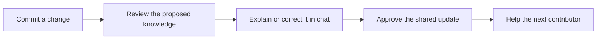

# Knect

### Knowledge + Connect
**Turn code changes into knowledge your team can trust.**

Knect is a Meta-powered VS Code extension designed to preserve the reasoning behind a project as the team builds it. It connects code changes with the decisions, experiments, failures, and precautions that help other contributors understand the work.

After a developer commits a change, Knect prepares a proposed knowledge update and offers it for review. The developer can correct the explanation in chat, add the reasoning that code cannot reveal, and approve exactly what becomes part of the team’s shared memory.

> **Status:** Product design finalized; development has not started. This README describes the intended experience. Architecture, delivery milestones, evaluation, and operating constraints are documented in [PLAN.md](PLAN.md).

## Keep the reasoning alongside the work

Repositories preserve changes, but the explanation behind those changes often remains in someone’s memory or disappears into a conversation. A future contributor may discover what changed without understanding which experiment justified it, what previously failed, or why a particular constraint matters.

Knect captures that context while it is still fresh. Approved contributions remain connected to their author, source commit, supporting evidence, and applicable conditions, giving the team a shared understanding that can be inspected and revised.

## A natural part of the development workflow

Knect notices new commits in an enabled repository and presents a notification with the option to review now or later. The review panel shows the proposed findings, relevant evidence, and any questions the model cannot answer confidently. Nothing becomes shared knowledge until an authorized person approves it, and Git commits and pushes continue normally.

For example, a change reduces retries from five attempts to two. Knect can see the modification, but it should not invent the reason. The developer explains: “Long retries were creating duplicate jobs after a timeout; this was not a performance optimization.” Knect incorporates that explanation, links it to the change, and presents the revised contribution for approval.

## A shared memory that remains useful

Team members can contribute implementation notes, experimental results, decisions, and warnings to the same workspace. Knect connects related findings and compares their conditions before treating different results as a contradiction.

A contributor working on a file can inspect relevant guidance beside the code. A newcomer can ask what they need to know about a component and receive an explanation covering its purpose, important decisions, known failures, and unresolved questions—with references to the underlying evidence.

When later changes affect existing guidance, Knect proposes a reassessment. Previous interpretations remain available, so the team can understand both the current recommendation and how it developed.

## Review improves future contributions

Accepted corrections become part of the project’s memory. Future proposals can reuse relevant explanations and explicitly approved team rules, reducing repeated misunderstandings while keeping feedback tied to its original context.

Knect distinguishes code observations, contributor explanations, and model interpretations. It preserves uncertainty when evidence is incomplete and never treats a generated statement as proof simply because it sounds confident.

## Built around developer control

Knect lives inside VS Code through a sidebar, review panel, chat, and evidence links. Repository monitoring is enabled explicitly, and developers can approve individual knowledge items, revise them, reject them, or leave them for later.

Sensitive content is scanned locally before model requests. Enabling Meta analysis permits selected sanitized evidence to leave the device for inference; approving publication is a separate decision that controls what teammates can access.

The first release uses a local service and supports separate authenticated contributor sessions on one laptop. Hosted access for geographically distributed teams is a later extension of the product.

**Code records what changed. Knect helps the team retain why it mattered.**

Read [PLAN.md](PLAN.md) for the complete engineering and delivery plan.

